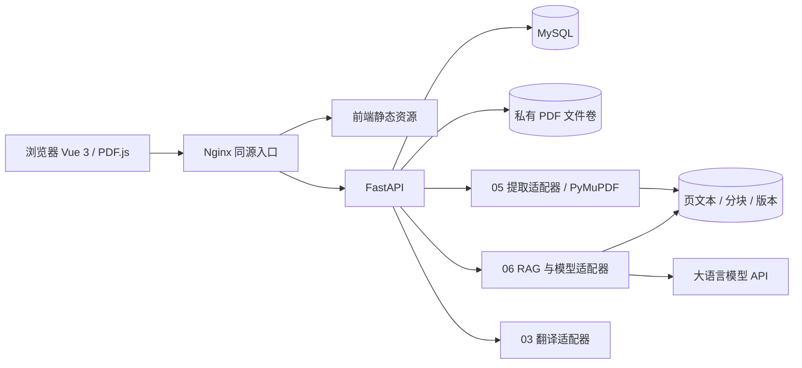

# 系统总体架构

## B/S 技术链路

浏览器运行 Vue 3 + TypeScript + Element Plus；PDF.js 渲染经认证接口获取的 PDF。Nginx 提供前端静态资源与 SPA 路由回退，将 `/api/v1/` 转发到 FastAPI。FastAPI 校验普通用户身份、资源归属和输入，经数据库访问层读写 MySQL，通过私有文件服务访问本地 PDF 存储。



E、Q、X 为未来模块，第一阶段不加载、不调用供应商、不创建专用表。图描述目标链路，不代表已部署。04 笔记属于 API 和 MySQL 内的独立业务域。

## 建议目录（仅设计，不创建代码）

```text
frontend/
  src/
    app/                 # router、主题、启动配置
    api/                 # HTTP 客户端与按模块 API
    contracts/           # 公共 DTO、ReaderContext、事件类型
    components/layout/   # Sidebar、ResizablePanel、FloatingAssistant
    modules/auth/        # Change 01
    modules/library/     # Change 01
    modules/reader/      # Change 02
    modules/translation/ # Change 03，后续创建
    modules/notes/       # Change 04，后续创建
    modules/extraction/  # Change 05，后续创建
    modules/qa/          # Change 06，后续创建
    tests/
backend/
  app/
    api/v1/              # auth、documents、reader 等路由
    core/                # 配置、会话、异常、权限
    models/              # ORM 实体，按阶段建立
    schemas/             # Pydantic DTO
    services/            # auth、storage、library、reader；其余后续
    repositories/        # 统一 owner 过滤
    integrations/        # PDF 提取、翻译和 LLM 适配器，后续
  migrations/            # 分模块、版本化迁移
  tests/
docs/design/             # 本批公共设计
openspec/changes/        # 六模块规划
storage/                 # 开发期私有数据，禁止提交 PDF
scripts/                 # 后续开发/验证辅助脚本
```

建议 ORM 采用 SQLAlchemy、迁移采用 Alembic，在 Change 01 启动时锁定依赖版本并记录。不是本批已经安装的依赖。

## 认证与权限

建议采用服务器会话 + 不透明随机会话 ID；Cookie 为 HttpOnly、SameSite=Lax，生产启用 Secure。MySQL 保存会话 token 的哈希、用户、过期与撤销状态；退出撤销该会话，过期返回 401。密码采用 Argon2id 哈希，不存储明文。写请求携带与会话绑定的 CSRF token，并校验 Origin；登录/注册同样校验 Origin，避免登录 CSRF。具体参数见待确认表。

同源部署使 PDF.js 携带 Cookie 读取内容，不需要把凭证放在 URL 或 localStorage。前端路由守卫仅用于交互，后端对每次读取、写入、下载、引用、解析任务查询都校验 owner。不存在、他人资源与已删除资源统一返回 404，避免泄漏用户文献。

第一版只有普通用户；各用户私有文献、目录、标签、笔记和问答数据独立。产品名称中的“协作”本期指团队协同开发及模块集成；群组共享、邀请、跨用户共读没有已给定需求，须另立 change。

## 文件与数据一致性

上传验证大小、内容类型与 PDF 签名；文件名作为展示字段，服务器生成存储键并保证路径位于私有根目录。流式接收并计算 SHA-256；同用户已存在哈希时拒绝重复。临时文件写入成功后以原子移动发布；数据库失败回收临时文件，文件发布失败不提交可用记录。并发上传由唯一约束兜底。

不把 `storage/` 配置为 Nginx 静态目录。PDF GET 支持 Range、206/416、正确 MIME 和下载文件名。软删除屏蔽下载/阅读/派生任务；恢复保留关联；显式永久删除需删除文件与派生数据，失败记录待清理状态并重试，不返回虚假成功。详见数据模型。

## Docker Compose 服务规划

| 服务 | 作用 | 连接与数据 |
| --- | --- | --- |
| nginx | 静态前端与 API 代理 | 唯一对外入口；代理上传限额与 API 一致 |
| api | FastAPI | 内网连接 db；独占私有 PDF 卷；健康检查 |
| db | MySQL | 不对生产公网暴露；命名卷；健康检查与迁移 |

第一版三服务即可；前端 dev server 可在 Windows CMD 单独运行并代理 API。05/06 的持久任务初步采用 MySQL 作业表和独立工作进程，不把请求内临时后台任务当作可靠队列。是否增加 worker 服务及向量存储待后续阶段容量评估，本次不写 Compose 或启动容器。

部署顺序：配置校验 → db 健康 → 单次迁移 → api 就绪 → nginx。初始化失败应明确失败，不重建清空卷。保留数据库/PDF 卷联合备份；回退前检查迁移兼容性，破坏性回退用备份恢复。开发用 HTTP 时允许非 Secure Cookie；演示外网及生产用 HTTPS。

## 环境变量与配置

后续提供无秘密的 `.env.example`，实际 `.env` 与 PDF/数据库文件进入忽略规则。前端只有公开的 `VITE_API_BASE_URL`（建议 `/api/v1`），禁止前端接收 LLM 密钥。

| 后端配置 | 用途 |
| --- | --- |
| APP_ENV、PUBLIC_ORIGIN、COOKIE_SECURE | 环境、Origin/CSRF 与 Cookie |
| DATABASE_URL | MySQL 凭证；日志隐藏密码 |
| PDF_STORAGE_ROOT、MAX_UPLOAD_BYTES | 私有文件根目录与可调上传限制 |
| SESSION_TTL_SECONDS、SESSION_SECRET | 会话期限与 CSRF 签名密钥 |
| LLM_BASE_URL、LLM_MODEL、LLM_API_KEY | 06 启用时由服务端读取 |
| TRANSLATION_PROVIDER、TRANSLATION_API_KEY | 03 启用时由服务端读取 |
| EMBEDDING_MODEL、EXTRACTION_TIMEOUT_SECONDS | 05/06 未来配置 |

配置按环境文件/部署变量覆盖默认值；缺少启用模块必要配置启动失败或明确禁用该模块。异常和日志不输出密码、会话、API key 或完整用户文献正文。

## Git 协作约定

建议建立 main 集成分支，成员使用 `codex/<change>-<topic>` 或项目约定的 feature 分支；当前尚未创建分支或提交。一个 PR 只对应一个 change 或公共契约的清晰增量。提交描述关联 change 名，PR 附场景、迁移、接口变化与测试证据。

三人可并行维护各自模块；公共 DTO/API/会话/迁移由受影响成员共同审阅，不能各自复制不同格式。迁移编号串行合并，避免冲突；使用迁移创建测试库，禁止直接修改共享数据库。合并前 OpenSpec strict 校验、模块测试和契约测试通过。API v1 不兼容变更先提规格变更及迁移说明。截图、规划和代码状态分开记录。
