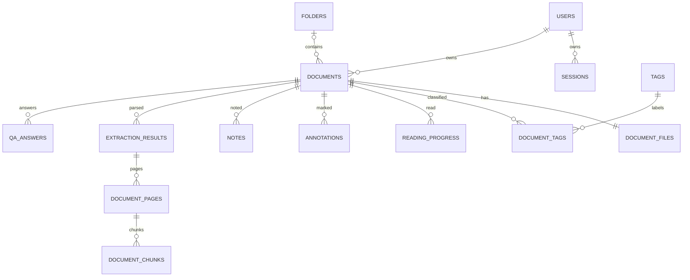

# 数据模型说明（已实现阶段与后续逻辑模型）

## P3-B2 增量实现（2026-10-16）

`0006_reader_assets`接0005，只新增reader_assets及owner/document/status索引，不重建或清空旧表。字段：id、owner_id（users外键）、document_id（documents外键）、storage_key（唯一、私有）、sha256（规范化字节哈希）、mime_type、width/height、size_bytes、status、attempts、error_code、created_at、expires_at。时间沿用MySQL DATETIME(6)/SQLite DateTime。status为uploading/ready/cleaning/failed/deleted；活动引用expires_at=null，临时上传租约1小时，最后活动对象删除或替换后租约24小时。删除成功保留台账且排除容量计算；文献永久删除最终移除资产行。

annotations仍复用0005的JSON/asset_id字段，应用层校验asset owner/document及有效状态，不改原业务表。type现开放13类；ink使用points，形状与插入使用box，水印允许对象角度；circle/image/signature校验物理比例。新对象与旧六类共用独立集合CAS、对象version、命令收据和墓碑。上传先台账后文件，资产清理先持久化intent再删文件；失败可查询重试。软删保留，永久清理纳入原cleanup_jobs。

生产者models.py/reader_assets.py/annotations.py，消费者阅读器assets.ts/annotations.ts及对应页面层。真实MySQL仅离线DDL，自动迁移保留旧数据的测试为隔离SQLite，不等同业务MySQL升级验收。下文B1/规划历史中的“尚无资产/仅六类”由本节覆盖。详见 [B2记录](../development/p3-b2.md)。

## P2-B当前实际数据（2026-10-14）

0003_library增量创建folders/tags/document_tags/reading_progress/cleanup_jobs，documents只新增nullable folder_id、last_read_at和purge_job_id；不删除既有数据或重建documents。外键文件夹SET NULL、标签关联/进度CASCADE，分类删除API主动递增受影响文献version。名称保存name和NFKC+casefold的normalized_name，UNIQUE(owner_id,normalized_name)保证用户内重复检查；每个分类/关联写入复验owner。

DocumentTag复合主键(document_id,tag_id)，ReadingProgress以document_id为主键，仅个人文献所有者一条记录。last_read_at在MySQL使用DATETIME(6)，保持快速重复打开的时间顺序，01历史记录的page_number/zoom可为null，A2支持实际值。索引(owner_id,folder_id)、(owner_id,deleted_at,last_read_at)及关联owner/tag索引支撑查询。

CleanupJob以document_id唯一，刻意不设置文献外键以保留删除完成审计，owner外键保留。字段status/attempts/error_code/storage_key/lease_expires_at及创建更新时间记录pending→running→completed/failed。documents.purge_job_id为不可恢复标记，无循环FK；作业意图先提交、再清文件和关联，60秒租约允许显式恢复中断作业，尝试编号+清理期间作业写锁阻止并发重复执行。完成后storage_key置null，失败保留可查询状态和重试入口，不向DTO暴露存储键。该作业仅处理明确永久删除；上传进程硬退出留下的孤儿文件尚无自动扫描器。

本轮隔离SQLite升级验证保留原文献ID、题录、附件键及账号；MySQL实际迁移/约束验收由用户手动执行，见[P2-B记录](../development/p2-b.md)。下文P2-A阶段叙述作为历史记录，其他成员实体仍是后续规划。

P1已实现users/sessions；P2-A已实现documents/document_files；P2-B已实现本节列出的分类/进度/清理实体。annotations及03–06实体仍为后续目标。用户已确认Change 01功能/UI验收通过；专项MySQL测试证据与历史SQLite证据分开记录，见[交接](../../HANDOFF.md)。

## 统一约定

MySQL，utf8mb4；ID 建议 UUID 字符串；时间用 UTC DATETIME(6)，API 转 ISO 8601。实体共有 id、createdAt、updatedAt；可并发修改实体增加 version。所有私有业务实体有 ownerId；由会话用户赋值。关联同时验证双方 owner 一致，索引/外键不能替代业务权限校验。

## 实体与阶段

阶段历史：P2-A新增0002_documents，当时分类与阅读字段未落地；其限制已由0003_library解除，现有文献持久化folder_id、标签及last_read_at，删除/恢复API已实现。两次迁移均保留既有数据。SQLite测试启用外键，专项MySQL证据不能由SQLite结果推断。

02 A2接入：page_count在首次非空进度保存时由pypdf验证/缓存；reading_progress.page_number为nullable Integer、zoom为nullable VARCHAR(20)，API读取转换为number。02复用原表和独立progress.version，增加服务端物理页数验证及实际页码/缩放保存；annotations按下表增量迁移，软删除保留、恢复复用、永久清理必须覆盖新增关联。所有新增页码均为物理1-based，标注位置按未旋转页面归一化，不改写原PDF。具体缺口见[02接入核对](../../openspec/changes/02-pdf-reader/design.md)。

| 实体 | 关键字段与约束 | 首次实现 |
| --- | --- | --- |
| users | emailNormalized UNIQUE、email、passwordHash、displayName；无 role/admin 字段 | 01 登录页 |
| sessions | userId FK、tokenHash UNIQUE、expiresAt、revokedAt、csrfNonce；退出可撤销 | 01 登录页 |
| documents | ownerId、folderId nullable、title、authors JSON、abstract、keywords JSON、year nullable、journal、doi、version、deletedAt、parseStatus、extractionVersion nullable、pageCount nullable | 01 文献库 |
| document_files | documentId UNIQUE FK、ownerId、originalName、storageKey UNIQUE、sha256、sizeBytes、mimeType；(ownerId,sha256) UNIQUE | 01 文献库 |
| folders | ownerId、name；(ownerId,nameNormalized) UNIQUE；首版单层 | 01 文献库 |
| tags | ownerId、name、color nullable；(ownerId,nameNormalized) UNIQUE | 01 文献库 |
| document_tags | ownerId、documentId、tagId；(documentId,tagId) UNIQUE | 01 文献库 |
| reading_progress | 原owner/document/pageNumber/zoom/lastReadAt/version保留，02增nullable viewMode/zoomMode；旧空请求兼容 | 01 打开记录，02 扩充 |
| cleanup_jobs | ownerId、documentId、storageKey、status、attempts、errorCode；独立清理记录防止文件孤儿 | 01 回收站 |
| annotations | owner/document、13类type、schemaVersion、pageNumber、position/geometry/style JSON、selectedText/content/color、assetId/zIndex/version/时间 | 02 B1/B2 |
| document_reader_state | documentId唯一、ownerId、annotationRevision；与对象写同事务CAS | 02 B1 |
| annotation_command_receipts | owner/document/commandId唯一、请求指纹、结果/修订号、过期时间；幂等/在途核对 | 02 B1 |
| reader_assets | owner/document、私有key、mime/hash/像素尺寸/引用/租约/过期状态；PNG/JPEG | 02 B2 |
| translation_results | ownerId、documentId、pageNumber、source/targetLanguage、sourceText、translatedText | 03，支持后续 Note sourceId |
| notes | ownerId、documentId、pageNumber nullable、annotationId nullable、title、content、sourceType、sourceId nullable、originalText、translatedText、citations JSON、version | 04 |
| extraction_jobs | ownerId、documentId、fileHash、status、attempts、errorCode、versionId；同文件版本最多一个活动作业 | 05 |
| extraction_results | ownerId、documentId、extractionVersion、fileHash、metadata JSON、fieldSources JSON、warnings JSON；(documentId,extractionVersion) UNIQUE | 05 |
| document_pages | ownerId、documentId、extractionVersion、pageNumber、text；(documentId,extractionVersion,pageNumber) UNIQUE | 05 |
| document_chunks | ownerId、documentId、extractionVersion、pageNumber、startOffset、endOffset、text | 05 |
| qa_answers | ownerId、documentId、extractionVersion、question nullable、mode、answer、status、citations JSON | 06 |
| rag_indexes | ownerId、documentId、extractionVersion、indexStatus、isActive、embeddingModel、indexKey；同文献最多一个活动索引；向量后端外置或嵌入式待定 | 06 |

02对象目标为13类：B1六类+手绘+三形状+三插入。2026-10-16取消独立荧光笔；当前业务API只接受B1六类，此调整不改数据库结构或已有记录。

翻译结果与问答答案作为可保存来源，暂不规划会话历史/多轮聊天页面；具体保留时长待配置决定。sourceType/sourceId 的多态关系由服务层校验，不伪称数据库可以用单个外键关联多张表。annotation 删除后 notes.annotationId SET NULL，保留笔记中的原文快照。首次阶段不提前创建 03–06 表。

## 查询、权限与索引

文献查询固定过滤 ownerId、deletedAt；常用索引 `(ownerId,deletedAt,createdAt)`、`(ownerId,deletedAt,lastReadAt)`、`(ownerId,folderId,deletedAt)`，关联索引 tagId/documentId。首版个人库规模按参数化 LIKE 元数据搜索，文本全文索引优化在容量确定后评估；不是 06 向量检索。最近阅读由真实打开/进度提交写入服务器时间，列表 GET 不修改历史。

用两用户隔离样例验证猜测 ID、替换 folderId/tagId、跨文献 annotation/source/chunk、下载 Range、搜索/回收站/作业状态。UUID 只是标识，不能作为权限防线。上传不跨用户去重共享存储，从而简化删除与隔离。

## 生命周期

上传新文献 + 一份附件；元数据可人工编辑，文件不可覆盖替换。重复 UNIQUE 涵盖软删除记录，恢复不会触发第二份附件；永久删除完成后可重新上传。单层文件夹删除令 folderId=null，标签删除清关联；这些操作同时处理回收站文献，恢复时若分类已不存在则归未分类。

软删除 documents.deletedAt，保留文件/标注/笔记/解析数据，但所有普通查询和派生入口隐藏。恢复原记录，关联恢复可用。永久删除先标记不可恢复且记录 cleanup_job，清理文件、正文/索引与来源后删除数据库关联记录；若外部向量或文件清理失败，job=failed/待重试，接口不能报告全部删除成功。cleanup_job 自身在完成后只保留必要审计状态，不能继续泄漏文件路径。

人工元数据 version 与提取版本不同。05 默认写候选结果，不自动覆盖现有正式题录；用户选择候选后经 01 PATCH CAS 更新。05 原子发布完成版本并更新 documents.extractionVersion（最新完整提取），06 用 rag_indexes.isActive 指定已就绪的问答版本，二者不要求同时切换。重解析时06旧索引保持有效，新索引就绪后原子切换活动索引；若无任何活动索引返回503。答案明确其实际引用版本；旧回答引用保留的版本或明确“来源版本已失效”，不得悄悄跳到新文本。

迁移按01 P1→P2-A→P2-B→02→未来模块增加表；0001_auth/0002_documents/0003_library已提供，02–06业务表尚未创建。数据库与PDF卷一起备份；新增外键/唯一约束前核查现有数据，升级失败回退兼容应用或恢复备份。当前只在隔离测试库执行迁移，实际MySQL部署待用户手动操作。

## Change 02 增量补充（2026-10-15，仅规划）

以[02设计](../../openspec/changes/02-pdf-reader/design.md)为细节真源。pypdf已锁定且上传已结构校验，02按需补真实page_count，不依赖05；不重建progress或修改原PDF/题录。zoom仍字符串倍率，API0.5–5，新增模式nullable/default兼容旧数据。多页锚点按未旋转CropBox归一化，几何/笔宽/样式类型校验。

对象集合CAS与单对象version、题录/progress/contextRevision分离；删除也校验版本，undo为补偿写而非数据库回滚历史。未引用资产/延迟删除资产和导出引用租约分别处理，所有新文件只能私有访问；永久清理纳入原cleanup_jobs，软删屏蔽、恢复同ID。导出作业/快照的具体持久表由C1选型后冻结，本轮只执行隔离测试库的0004迁移，不提前创建标注/资产/导出表，更不创建03–06实体。

## P3-A2 增量迁移（已实现）

`0004_reader_progress`接`0003_library`，只ALTER原reading_progress增加nullable VARCHAR(16) view_mode/zoom_mode，旧记录/页码/倍率/版本/时间原样保留，读取时默认continuous/fit-width。不删除或重建表，无原PDF变更；A2当时head为0004；当前head已为0005_annotations，后续成员从当前head串行协调编号。物理页数缓存不递增题录version；progress.version独立CAS。旧PUT {}保留已有状态并记打开；新进度写recordOpen=false不修改Document/ReadingProgress的last_read_at。SQLite从0003升级保留测试和MySQL离线DDL编译通过，真实MySQL升级/并发集成仍需单独验证，不能把离线DDL或SQLite称为MySQL集成通过。

## P3-B1 增量迁移（已实现）

`0005_annotations`唯一接在`0004_reader_progress`之后，开发前后均检查versions目录，没有其他分支迁移。只新增annotations、document_reader_state、annotation_command_receipts及索引；原表、原文件、账号/题录/进度无重建。SQLite从0004升级对users/documents/document_files/reading_progress全行比较保留，MySQL仅离线生成DDL，真实MySQL尚未运行。

annotations含id、owner_id、document_id、type、schema_version、page_number、position/geometry/style JSON、selected_text/content、color、asset_id(null)、z_index、version、created_at/updated_at/deleted_at。B1仅六类，type/schemaVersion/文本锚点不可PATCH；时间为服务器UTC，MySQL DATETIME(6)；selected_text/content使用MEDIUMTEXT以覆盖20k Unicode字符的多字节存储，SQLite仍为Text。deleted_at为受控恢复的墓碑，删除也递增对象version；恢复要求同owner/文献/ID、原快照及删除前version匹配，不从任意客户端快照新建。墓碑保留到文献永久删除，撤销历史只在当前阅读会话保留100条。索引(owner,document,page)和(document,updated)；对象id全局唯一，跨归属ID不允许关联。

document_reader_state以document_id为主键、owner索引，annotation_revision从0开始，对象创建/修改/删除/恢复每次同事务+1；不改变题录version/progress.version。所有变更先锁有效Document行，再用当前读检查集合及对象CAS，解决首次写入和MySQL REPEATABLE READ快照问题；GET集合也取同一文献锁以返回一致的revision与对象。

annotation_command_receipts以(document_id,command_id)复合主键、owner索引、expires_at索引，保存请求指纹及完整MutationResult，24小时有效；同ID不同请求409，重复相同请求返回原结果。过期行在该文献后续成功写入时清除，过期查询404且客户端不得盲重放。对象、修订号、收据同事务提交；故障注入验证没有部分结果。软删只屏蔽访问，恢复原ID保留对象；原cleanup_jobs在同一数据库清理事务显式删除收据/对象/状态，失败仍保持可追踪并支持幂等重试。downgrade主动拒绝删除标注，应用回退应保留数据。

字段规则及限额见[API契约](api-contracts.md)和[B1开发记录](../development/p3-b1.md)。B2复用这三张表并增量扩展类型/资产校验，B2现已新增reader_assets，03–06表仍未建立。

### B1选区JSON兼容增强（2026-10-16）

annotations原position/geometry JSON容纳可选逐item字符范围textRanges和rect.baseline字体比例；schemaVersion仍1，无新迁移/列/表，原记录不批量改写。基线比例仅辅助线条显示，原归一化CropBox矩形仍为几何锚点；旧对象缺省比例0.8。API范围约束见契约末节。既有集合/对象版本、命令收据、墓碑恢复、归属和生命周期保持原规则。
