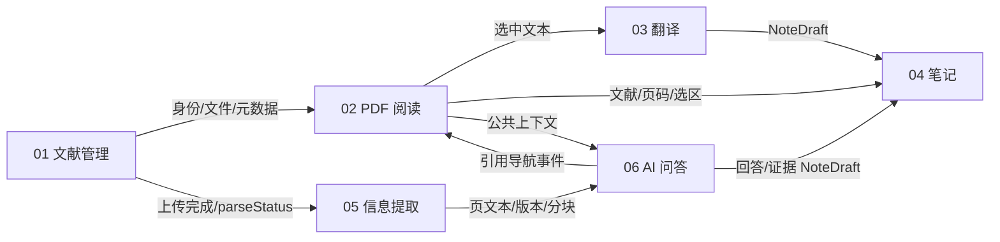

# 模块边界与依赖

当前01已通过用户实际功能/UI验收，02 A1/A2已实现，B/C及03–06仍未实现。01可直接复用的身份/文件/题录/打开记录代码及02缺口见[交接](../../HANDOFF.md)和[02接入核对](../../openspec/changes/02-pdf-reader/design.md)。下文ReaderContext/NoteDraft/引用导航为公共目标契约，A2已提供真实context.ts类型/可取消事件；完整引用导航adapter留C2。

| 模块/负责人 | 拥有的数据与行为 | 使用公共契约 |
| --- | --- | --- |
| 01 Jensen Zhang | 普通用户认证、私有文件、文献元数据、文件夹/标签、回收站 | 当前用户、DocumentDTO、PDF 内容接口 |
| 02 Jensen Zhang | 阅读、选区、13类标注/插入、进度、批注导出、多标签与布局 | 01 权限/文件，ReaderContext、NoteDraft、引用跳转 |
| 03 Siguo Liu | 中英选区翻译、原译文展示/复制 | 02 context；通过 04 保存笔记 |
| 04 Siguo Liu | 个人笔记 CRUD、来源关联、个人搜索 | 01 文献权限；02/03/06 NoteDraft |
| 05 Jialu Ma | 元数据候选、页文本、分块、人工校正与提取版本 | 01 上传扩展点；发布 ExtractionResult |
| 06 Jialu Ma | 当前文献摘要、结构解析、RAG 问答和证据 | 05 页文本/分块版本；02 context、引用跳转；04 保存回答 |

这些箭头是数据依赖，不是必须互相导入代码的循环依赖。公共 contracts 和事件中介承载跨模块交互；01 不调用 02，02 不实现翻译、笔记或问答。

01 交付时仅保留 `parseStatus=not_requested` 和内部 DocumentUploadedV1 契约，不实例化 05、任务系统或假提取。05 交付后再启用触发适配器；05 失败不能回滚已上传文献。02 交付前，03/04/06 可审阅并按共享类型独立开发服务，接入仍须阅读器就绪。05→06 的正文/页码契约是问答上线门槛，不允许用随机回答或未解析全文替代 RAG。

模块接入流程：负责人审阅 DTO → 本模块实现/单测 → 使用真实权限接口联调 → 验证取消/切换文献/失败状态 → 启用对应入口。未接入 04 时，03/06 的保存笔记按钮禁用并说明；复制真实结果仍可用。

公共接口修改：提出对应 OpenSpec 更新、列举生产者/消费者、共同审阅、更新 API 文档和契约测试。01 的元数据 PATCH 是唯一正式题录写入口；05 提供候选与人工选择，不绕过权限或覆盖手工字段。跨用户共享与管理员权限完全不在本期依赖图内。

## 02 本轮边界修订（2026-10-15）

02右区只有PDF搜索/批注列表，独立于04。仅预留ReaderContext/SelectionPosition、NoteDraft/Citation和可取消订阅事件/导航adapter，不实现03–06工作区、机器人、翻译面板、笔记页、聊天/模拟服务或业务表。未接入adapter返回unavailable，不做占位业务UI。contextRevision工作区单调增长，消费者丢弃documentId/revision过期响应；后端逐次校验owner/嵌套关联，不能把上下文当授权。03/04/06消费契约，05只需稳定documentId/物理页契约，02搜索不依赖05。详情见[02设计](../../openspec/changes/02-pdf-reader/design.md)。
